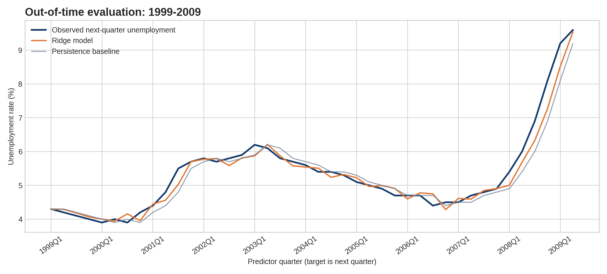
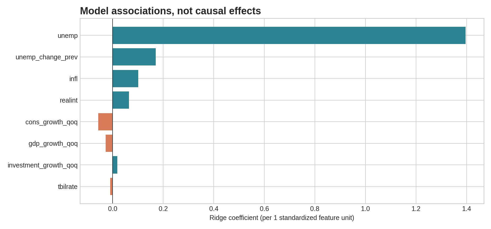

# U.S. Economic Cycle Forecasting

**An end-to-end forecasting case study with Python, SQL, chronological validation, and honest baseline comparisons.**



## Project question

Can economic indicators available in quarter **t** help predict the U.S. unemployment rate in quarter **t+1**, better than simply assuming unemployment stays unchanged?

This is a **retrospective historical analysis**, not a live investment or economic forecasting tool. Data cover **1959 Q1 through 2009 Q3**. The example uses revised historical data, which may differ from the values known at the time.

## Test-set results

| Method | Test MAE (percentage points) | Test RMSE (percentage points) |
|---|---:|---:|
| Ridge regression (CV-tuned) | **0.1763** | **0.2542** |
| Persistence baseline: next quarter = current quarter | 0.2405 | 0.3674 |

- **159 training observations:** 1959 Q2–1998 Q4.
- **42 held-out observations:** predictor quarters 1999 Q1–2009 Q2; targets extend through 2009 Q3.
- `Ridge(alpha=0.01)` selected by **five expanding-window, 12-quarter validation folds** confined to the training period.
- Target: next-quarter unemployment rate in percent. MAE is measured in **percentage points**, not percent accuracy.
- The retrospective result reflects this particular split; do not interpret it as a guarantee for other periods.

## What I built

1. Imported and validated a documented U.S. macroeconomic quarterly dataset.
2. Engineered quarterly GDP, consumption, and investment growth; previous-quarter unemployment change; and current inflation, short-term interest rates, and unemployment.
3. Created an expanding-window validation process that never trains on future observations.
4. Compared tuned ridge regression against a strong, interpretable persistence baseline on a chronological holdout.
5. Exported model metrics, out-of-time predictions, a SQLite database, three runnable SQL analysis results, and publication-ready visualizations.
6. Added automated tests and GitHub Actions for reproducibility.

## Reproduce locally

```bash
python -m venv .venv
source .venv/bin/activate  # Windows: .venv\Scripts\activate
pip install -r requirements.txt
python -m pytest -q
python -m src.pipeline
```

No API keys or external data downloads are required. The historical CSV is included. The pipeline recreates all items in `reports/` and is deterministic.

## Repo map

```text
src/pipeline.py                 Features, model selection, evaluation, plots and SQLite
sql/analysis.sql               Three analytical queries
data/us_macro_1959_2009.csv   Original historical quarterly values
reports/metrics.json           Verified out-of-time model and baseline metrics
reports/test_predictions.csv   One observation per held-out predictor quarter
reports/macro_analysis.sqlite  SQLite database with raw and engineered tables
reports/sql_result_*.csv       Saved results of the SQL queries
reports/figures/              Forecast and coefficient charts
tests/test_pipeline.py         Temporal integrity and correctness tests
.github/workflows/test.yml     CI checks
```

## Model interpretation



These coefficients describe **associations** in the fitted model after standardizing the inputs. They **do not establish causality** or policy effects. Unemployment is a persistent series, so the current unemployment rate is a useful forecasting feature, and the persistence baseline is important.

## Limitations and next steps

- The dataset is historical (ending 2009), small (203 quarterly rows), and subject to subsequent economic revisions. It is **not real-time-vintage data**, so real-world performance could be lower.
- The model is trained on one historical period and tested during a different regime including the financial crisis; larger rolling-origin evaluations and newer data would be worthwhile.
- This is an analytical demonstration; not a trading strategy, econometric causal claim, or business recommendation.
- Next step: rebuild with current Federal Reserve data and release-vintage data (e.g. ALFRED), then report several rolling test windows and data availability lags.

## Sources and provenance

- **Statsmodels macrodata**: https://www.statsmodels.org/stable/datasets/generated/macrodata.html
- Data source identified by statsmodels: **FRED (Federal Reserve Bank of St. Louis)**; see source notes for the component variables.
- This repository includes the statsmodels historical dataset for offline reproducibility; dataset source is attributed here. The model, SQL, plots and documentation are an original analysis built for this portfolio.

## Responsible portfolio use

The pipeline was prepared with AI development assistance. Before describing it as independently developed in applications or interviews, review the design, run the tests, explain the temporal split, and make improvements you personally understand and can defend.
